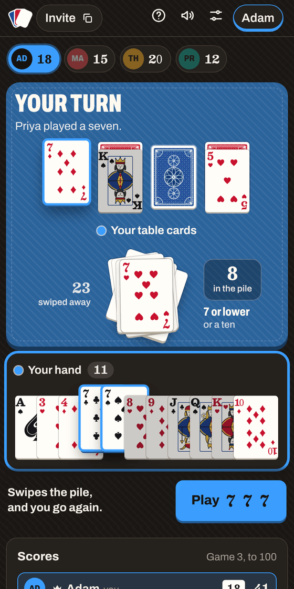
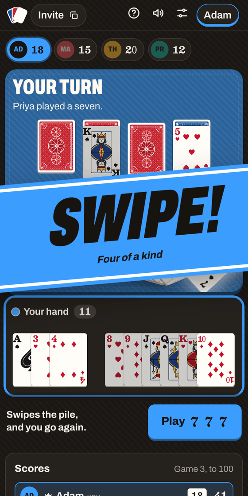
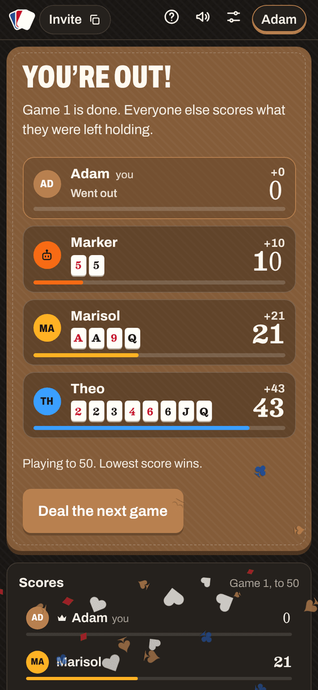
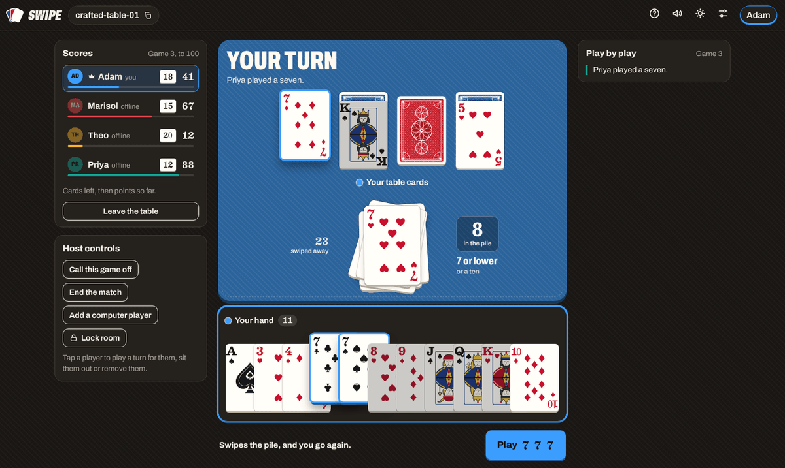

# Swipe

A self-hosted, real-time version of the card game Swipe for 3 to 24 players, played in the browser. Create a room, share the link, play from your phones.

Shed your cards onto the pile, equal or lower every time. Play a ten, or make four of a kind, and the whole pile is swiped off the table. First out wins the game; everyone else scores what they are left holding, and the lowest total wins the match.

Swipe is built on the same server as [Tradecraft](https://github.com/au12/tradecraft): one small Node process, rooms behind a link, no accounts, no database, no build step.

| Your turn | The swipe | Scores | Desktop |
| --- | --- | --- | --- |
|  |  |  |  |

## What you get

**The game**

- The server runs the rules: sets of one to four equal cards, equal-or-lower on the pile, picking up when you play higher, tens, four of a kind (laid at once or built up across turns), blind cards, going out, scoring.
- Two decks for 3 or 4 players and one more for every two players after that, mixed together, half red-backed and half blue.
- A match runs over as many games as it takes for someone to reach the points limit (100 unless the host changes it). The first lead goes to the highest hand; after that, whoever went out leads.
- Tap cards to build a set from your hand and your face-up row together. The button tells you what the set will do before you commit: go on the pile, swipe it, or cost you a pickup.
- Blind cards ask for confirmation, then flip for the whole table to see.
- Computer players, for filling a table or trying the game on your own.
- An optional turn clock. When it runs out the turn is played automatically. The host can pause it or add 30 seconds.
- A play-by-play log and a running scoreboard.

**The room**

- No accounts. A room is a link like `/r/lucky-riffle-42`.
- The first person in is the host: deal, add computer players, play a turn for someone who has wandered off, sit people out, remove them, hand over hosting, lock the room, change the points limit.
- Everyone gets a colour of their own. The mat in the middle of the screen takes the colour of whoever's turn it is.
- Players who drop reconnect into their seat with their hand. If the host disappears, hosting passes to someone else.
- People who arrive mid-match watch, and can ask to be dealt in from the next game. They start on the table's average score.
- Nobody is ever sent a card they could not see at a real table: your own hand, everyone's face-up row, a blind card once it is flipped, and the top of the pile. Everything else leaves the server as a card back.

**The table**

- Laid out for a phone held upright: whose turn it is at the top, their table cards, the pile in the middle, the hand below. Buttons under each section switch between the current player's cards and your own.
- The shuffle is a proper wash, then your own cards are dealt to you. Cards fly from where they are to where they are going, piles get scooped up, and a swipe looks like one.
- Sound effects are synthesised in the browser, so there are no audio files. Light and dark themes.

**Hosting**

- One dependency (`ws`). Fonts and card art are bundled; no external requests.
- Rooms are saved to a JSON file and survive a restart, including the clock.
- Works behind a reverse proxy, on a sub-path if you want.

## How the rules were read

The rule sheet leaves a few things open. These are the calls the game makes; each is one small place in [`public/js/rules.js`](public/js/rules.js) or [`server/game.js`](server/game.js) if you play it differently.

- **No jokers.** The sheet gives them no rank and no score, so each deck is the standard 52.
- **Face-up table cards can be played at any time**, on their own or together with matching cards from your hand. A blind card becomes playable as soon as the face-up card on top of it is gone, whether or not you still hold cards.
- **Several tens can go down together**, though one is enough to swipe.
- **Going out counts even if the last card is a swipe.** A last card that is too high does not go out: the pile comes home first.
- **Ties for the first lead** are settled at random among the tied hands. Hand totals use the scoring values (tens count 20).
- **The match ends when someone reaches the limit** (100 is enough; it does not have to be passed). Ties for the lowest score share the win.
- **Leaving mid-game** takes your cards out of play. Your score is kept in case you come back.

## Run it

### Docker Compose

```sh
git clone <this repo> swipe && cd swipe
docker compose up -d --build
```

Open <http://localhost:3001>. Saved rooms live in `./data`. (The compose file maps host port 3001 so Swipe can run next to Tradecraft; change it to whatever you like.)

### Docker

```sh
docker build -t swipe .
docker run -d --name swipe -p 3001:3000 -v "$PWD/data:/data" --restart unless-stopped swipe
```

The container runs as uid 1000. If the folder you mount is owned by someone else, add `--user <uid>:<gid>` (on Unraid that is `--user 99:100`). If the app can't write to `/data` it still runs; it logs a warning and rooms won't survive a restart.

### Unraid

The repository includes a GitHub Actions workflow ([`.github/workflows/docker-image.yml`](.github/workflows/docker-image.yml)) that builds the image and publishes it to `ghcr.io/<your-username>/<repo-name>:latest` on every push, so nothing has to be built on the server.

1. Push this project to your own GitHub repository and wait for the **Build image** run on the Actions tab to go green.
2. Make the package public once: your GitHub profile, **Packages**, the package, **Package settings**, **Change visibility**.
3. In the Unraid terminal, create the data folder with Unraid's usual owner:

   ```sh
   mkdir -p /mnt/user/appdata/swipe
   chown -R 99:100 /mnt/user/appdata/swipe
   ```

4. Docker tab, **Add Container**, with Advanced View switched on:

   | Field | Value |
   | --- | --- |
   | Name | `swipe` |
   | Repository | `ghcr.io/<your-username>/<repo-name>:latest` (all lower case) |
   | Network Type | Bridge |
   | WebUI | `http://[IP]:[PORT:3000]` |
   | Extra Parameters | `--user 99:100` |
   | Port | container `3000`, host `3001` (or any free port) |
   | Path | container `/data`, host `/mnt/user/appdata/swipe` |

To update later, push your changes, let the workflow finish, then use **Check for Updates** on the Docker tab.

### Node, no container

Needs Node 20 or newer.

```sh
npm ci --omit=dev
npm start
```

A sample systemd unit is in [`deploy/swipe.service`](deploy/swipe.service).

## Configuration

Everything is an environment variable. All are optional.

| Variable | Default | What it does |
| --- | --- | --- |
| `PORT` | `3000` | Port to listen on. |
| `HOST` | `0.0.0.0` | Address to bind. |
| `SITE_NAME` | `Swipe` | The name shown on the page and in the browser tab. |
| `BASE_PATH` | *(empty)* | Set to e.g. `/swipe` to serve under a sub-path. |
| `CREATE_PASSWORD` | *(empty)* | If set, creating a room needs this password. Joining a room never does. |
| `DATA_DIR` | `./data` (`/data` in Docker) | Where `rooms.json` is written. |
| `PERSIST` | `true` | Set to `false` to keep rooms in memory only. |
| `ROOM_TTL_HOURS` | `48` | Idle rooms are deleted after this long. |
| `MAX_ROOMS` | `500` | Upper limit on rooms. |
| `MAX_PLAYERS_PER_ROOM` | `64` | Upper limit on people in a room, watchers included. 24 can be dealt in. |
| `ALLOWED_ORIGINS` | *(any)* | Comma-separated origins allowed to open the WebSocket, e.g. `https://games.example.com`. |
| `BOT_DELAY_MS` | `1000` | Roughly how long a computer player takes over a move. |
| `DEAL_MS` | `6400` | How long the shuffle-and-deal sequence gets before play opens. |
| `MESSAGE_BUDGET` | `40` | Messages one connection may send every five seconds. |
| `LOG_LEVEL` | `info` | `info`, `debug` or `silent`. |

The points limit and the turn clock are per room, in **Room settings**.

## Behind a reverse proxy

The app speaks plain HTTP and one WebSocket at `/ws`. The proxy has to pass the WebSocket upgrade through.

- nginx: [`deploy/nginx.conf`](deploy/nginx.conf)
- Caddy: [`deploy/Caddyfile`](deploy/Caddyfile)
- Traefik and Nginx Proxy Manager need no special settings beyond enabling WebSocket support.

For a sub-path, set `BASE_PATH=/swipe` and forward `/swipe/` to the app. It works whether or not the proxy strips the prefix.

If you put this on the public internet, consider setting `CREATE_PASSWORD` so strangers can't open rooms on your server, and `ALLOWED_ORIGINS` to your own address.

## How it is put together

```text
server/
  index.js    HTTP (static files, small JSON API) and the WebSocket endpoint
  rooms.js    rooms, players, seats, host controls, computer players, the turn
              clock, the running score, saving to disk, and the per-player view
              (who is allowed to see what)
  game.js     one deal of the cards, as pure functions over a plain object
  names.js    room codes
  config.js   environment variables
public/       the client: plain HTML, CSS and ES modules, served as-is
  js/rules.js   what a set of cards does to the pile. The server enforces it
                and the browser previews with it, from this one file
  js/cards.js   the cards themselves, drawn as SVG
  js/view.js    everything on screen, as functions from a snapshot to HTML
  js/fx.js      motion: flights, the wash, the swipe, confetti
  js/sound.js   sound effects, synthesised with Web Audio
  js/app.js     the connection, taps, dialogs, and the order things animate in
test/         rules tests and end-to-end tests over real WebSockets
```

The server is the only source of truth. Each change produces a fresh snapshot per player, filtered to what that player may see, so a client can't learn a hidden card by reading network traffic. Clients send small actions; the server sends whole snapshots, each carrying the one event that produced it (`round.last`), which is what the browser animates.

### API

| | |
| --- | --- |
| `POST /api/rooms` | Create a room. Body `{ "password": "…" }` if `CREATE_PASSWORD` is set. Returns `{ "code": "…" }`. |
| `GET /api/rooms/:code` | `{ exists, players, locked }`, or 404. |
| `GET /healthz` | `{ ok, rooms, online, uptime }`. |

## Development

```sh
npm install
npm run dev     # restarts on server changes; the client has no build step
npm test        # rules tests + end-to-end tests that boot the server
```

## Licence and credits

GPL-3.0-or-later, the same licence as Tradecraft, whose server this one grew out of. See [`LICENSE`](LICENSE).

- The typefaces are [Archivo](https://github.com/Omnibus-Type/Archivo) by Omnibus-Type and [Besley](https://github.com/indestructible-type/Besley) by indestructible type*, both under the SIL Open Font License ([`public/fonts/`](public/fonts)).
- The card faces and backs were drawn for this project. They follow the look of a classic American poker deck and are not copies of any maker's artwork. Bicycle is a trademark of The United States Playing Card Company; this project is not affiliated with or endorsed by them.
